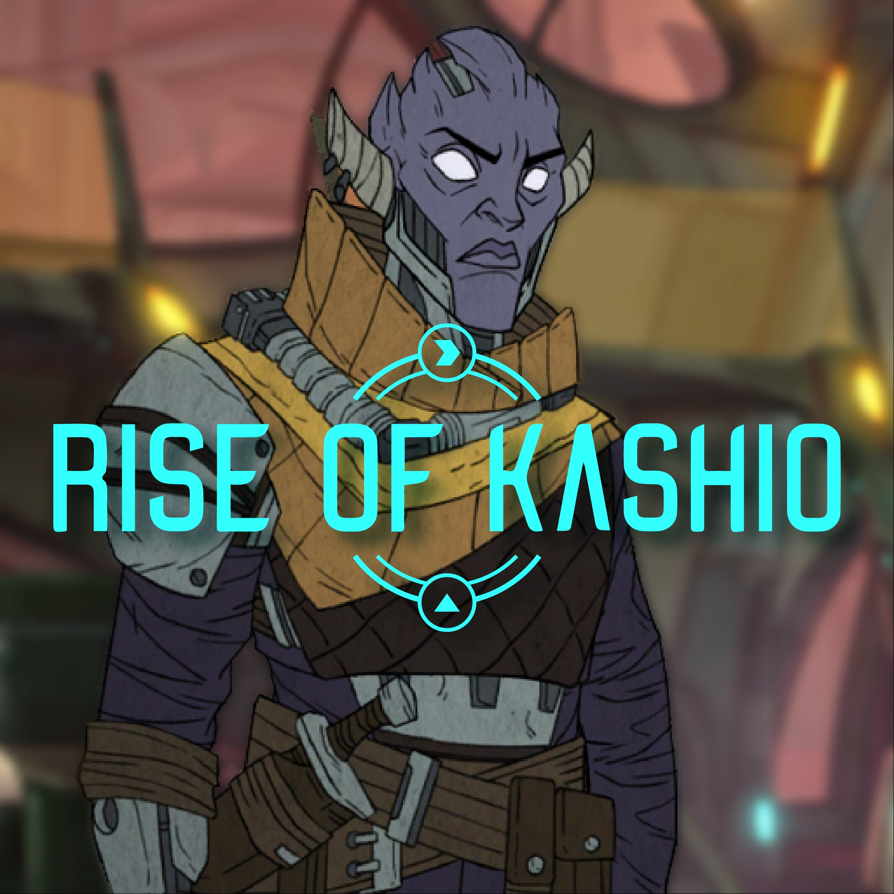
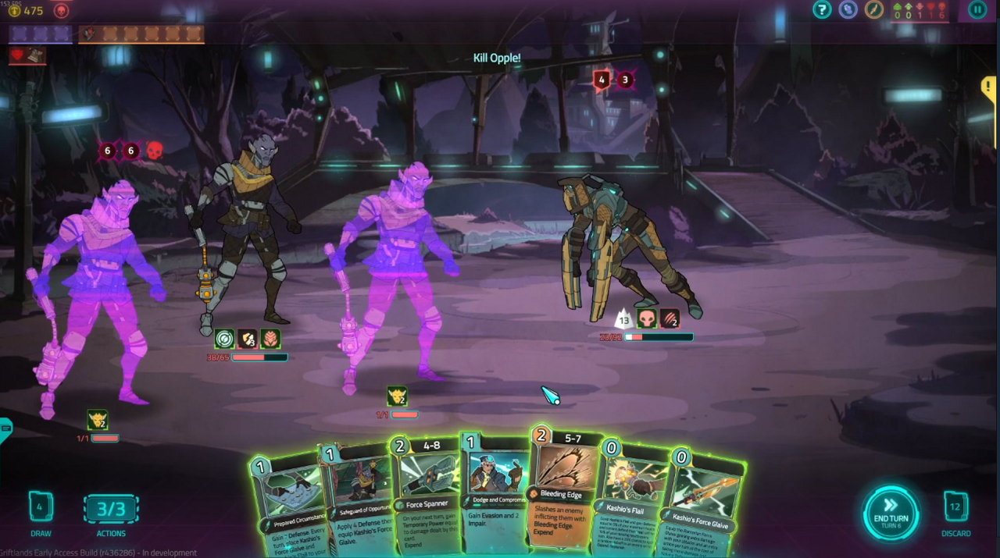
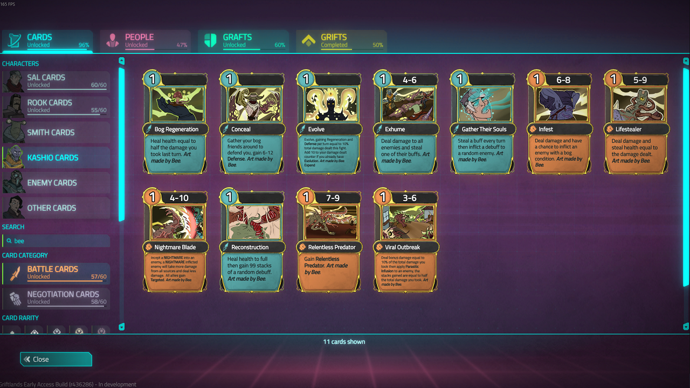
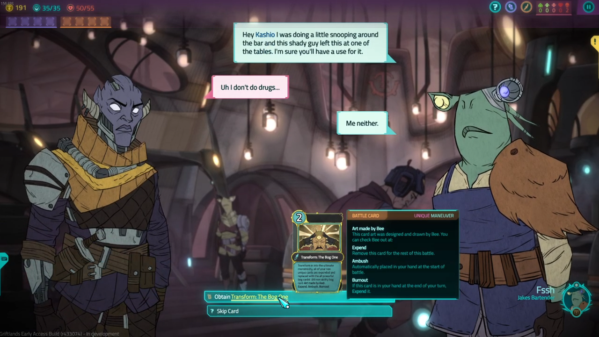

<div align="center">



# Rise of Kashio

**A character mod for [Griftlands](https://store.steampowered.com/app/601840) that adds a new playable character, 100+ battle cards, and a weapon-swapping combat style.**


[Steam Workshop page](https://steamcommunity.com/sharedfiles/filedetails/?id=2266976421) | [Klei forum thread](https://forums.kleientertainment.com/forums/topic/122796-mod-rise-of-kashio-demo/)

</div>

## Table of contents

- [Overview](#overview)
- [Screenshots](#screenshots)
- [How it plays](#how-it-plays)
- [Game modes](#game-modes)
- [Installation](#installation)
- [Project structure](#project-structure)
- [Development and testing process](#development-and-testing-process)
- [Known issues](#known-issues)
- [Credits](#credits)
- [License](#license)

## Overview

Rise of Kashio lets you play as Kashio, the aggressive, weapon-swapping fighter who appears as a boss in Griftlands. The mod was built as a solo project to create a character with a playstyle clearly different from the official ones, so she is intentionally strong and not balanced against the base game.

| | |
|---|---|
| **New content** | A playable character, 100+ battle cards, new conditions and abilities |
| **Playstyles** | 3 deck archetypes: Swap Weapons, Kingpin, and Bog Monstrosity |
| **Reach** | 7,218 unique visitors, 1,047 subscribers, and 60 favorites on the Steam Workshop (as of November 2026) |
| **Built with** | Lua, using the game's own modding framework |
| **Effort** | 200+ hours of development by the 2020 demo release |

> **Status:** Demo. The Workshop build was last updated in October 2020.

## Screenshots

<p align="center">
  <br>
  <em>A battle with Kashio's weapon cards, including Kashio's Flail and Kashio's Force Glaive, in hand.</em>
</p>

<p align="center">
  <br>
  <em>The card collection filtered to Bee's artwork, including Bog Regeneration, Infest, and Lifestealer.</em>
</p>

## How it plays

### Swapping weapons

Kashio has two main passive abilities, **Kashio's Flail** and **Kashio's Force Glaive**, and you can switch between them mid-battle. Some cards swap your weapon directly, some shuffle a swap card into your deck, and the **Swap Weapon** card lets you swap immediately or save it for later.

- **Force Glaive:** deals bonus damage when the enemy is not attacking.
- **Flail:** reduces the damage you take, gives passive defend, and grants an extra action on the following turn.

### Deck archetypes

**Swap Weapons** is the most flexible archetype. Typical play is to strike with the glaive while the enemy is idle, then switch to the flail before they attack.

**Kingpin** rewards committing to one weapon. After 6 consecutive actions with the same weapon (they can span turns), the card **The Execution** is added to your hand. Playing it activates Kingpin, and you gain a stack each time any combatant (you, allies, or enemies) takes an action. Swapping weapons while Kingpin is active resets your stacks. Cards tagged "Kingpin" gain bonus effects at higher stack counts.

| Stacks | Effect |
|---|---|
| 10 | Gain Metallic, and remove all bleed and wound on activation |
| 20 | Your attacks have a small chance to grant a random buff from a curated list |
| 30 | A random enemy gains Defect every turn |
| 40 | Every 3rd attack deals double damage and heals for half the amount |
| 50 | Summon a Spark Baron automech to fight for you (maximum 1) |

<details>
<summary><strong>Bog Monstrosity (spoilers: click to expand)</strong></summary>

<br>

The author kept this archetype a surprise for players, so it is hidden here.

Rare "Bog Ability" cards such as Parasite Infusion, Armor of Disease, and Contamination give you a condition called **One With The Bog**. Each turn it has a chance to shuffle a free Bog card into your hand, and at the end of every turn it expends one non-Bog card from both your draw and discard piles and replaces it with a Bog card. Bog cards are very powerful, so you slowly turn into a Bog Monstrosity.

The idea came from Bogtober, a Griftlands community event for Bog-themed content.

<p align="center">
  <br>
  <em>An event offering the card Transform: The Bog One.</em>
</p>

</details>

## Game modes

- **Battle Brawl:** a mostly complete mode for trying out all of the new cards, with custom events that let you draft some of the more powerful ones.
- **Rise of Kashio story campaign:** an experimental, incomplete short campaign written to learn how story quests are built. It is not representative of a final build and may crash. Battle Brawl is the intended demo experience.

## Installation

**Steam Workshop (recommended)**

1. Open the [Rise of Kashio Workshop page](https://steamcommunity.com/sharedfiles/filedetails/?id=2266976421) and click **Subscribe**.
2. Launch Griftlands and enable the mod from the in-game mod list. <!-- VERIFY: confirm the exact menu wording for enabling workshop mods -->
3. Start Battle Brawl to try the new character. <!-- VERIFY: confirm how players start Battle Brawl and the story mode -->

**From source (for modders)**

1. Clone this repository: `git clone https://github.com/bradleylim/riseofkashio.git`
2. Place the folder in your Griftlands mods directory.
3. Launch the game and enable the mod.

## Project structure

```text
riseofkashio/
├── modinit.lua                  # Mod entry point loaded by the game
├── rise_of_kashio.lua           # Main mod script
├── kashio_battle_cards.lua      # Kashio's battle card definitions
├── battle_grafts.lua            # Battle graft definitions
├── kashio_story_locations.lua   # Story campaign locations
├── characters/                  # Character definitions
├── quests/                      # Story quest scripts
├── textures/                    # Card art and other image assets
├── nameCardsScript/             # Helper script
├── about.txt                    # Workshop description text
├── steam_workshop.txt           # Steam Workshop item ID
└── preview.png                  # Workshop preview image
```
<!-- VERIFY: confirm what rise_of_kashio.lua and nameCardsScript/ do, then make their descriptions specific -->

## Development and testing process

I built this as a solo developer and treated each card like a small feature with its own test cycle.

1. **Design:** Draft a concept for the card based on something Kashio could plausibly do, according to the game's lore. Reuse the game's existing animations and in-game effects where possible. The goal was a distinct playstyle, so I leaned into strong, unusual ideas instead of balance. Kashio is a final-boss-level character in the lore.
2. **Implement:** Write the card, condition, or ability in Lua.
3. **Debug-tool testing:** Run the card through 10 to 20 scenarios using the game's debug tools, looking for crashes and unintended behavior.
4. **Integration testing:** Replay a full campaign and Battle Brawl runs to see how the card behaves in real play alongside other cards, grafts, and enemies.
5. **Volunteer playtesting:** Share the build with volunteer testers, who play normally and report feedback over about a week.
6. **Triage and release:** Fix the major reported bugs. Not every piece of feedback was accepted, since testers had strong views on lore and balance, so design requests were weighed against the project's goals. Once no new issues were reported, the content was marked complete and published to the Workshop.

## Known issues

Players have reported these on the [Workshop page](https://steamcommunity.com/sharedfiles/filedetails/?id=2266976421):

- The fight at the Admiralty gate repeating, or the dialogue looping, in the story campaign.
- The end-of-campaign dialogue repeating and then crashing the game.
- Some players start with no cards.

The Workshop build has not been updated since October 2020. Please open a [GitHub issue](https://github.com/bradleylim/riseofkashio/issues) with steps to reproduce if you find more.

## Credits

- **Mod author:** Bradley Lim (Steam: u lil nerd)
- **Card artwork:** created for this mod by Bee ([@OneTinyBeeDraws](https://twitter.com/OneTinyBeeDraws)), in collaboration with the author, for all non-Bog-Ability cards.
- **Griftlands** is created by [Klei Entertainment](https://www.klei.com/). Rise of Kashio is an unofficial fan-made mod and is not affiliated with or endorsed by Klei.

## License

The source code in this repository is released under the [MIT License](LICENSE). The card artwork is the work of its artist and is not covered by this license. If you are the artist and have concerns about how the artwork appears in this repository, please open an issue. Griftlands names, characters, and assets belong to Klei Entertainment.
